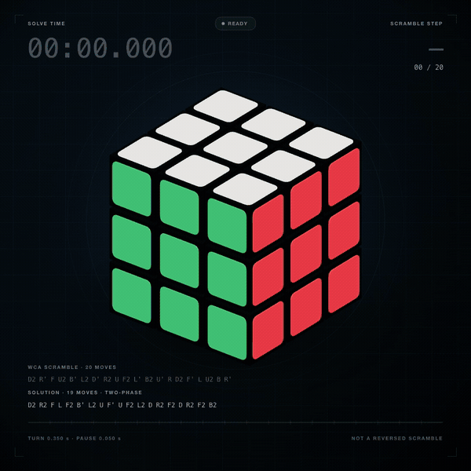
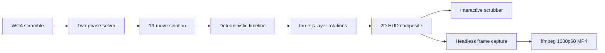

<div align="center">

# Rubik's Cube, in one file

**A deterministic 3×3 solve, rendered in a single 1080×1080 canvas.**

<p><a href="https://zhangfaen.github.io/rubik-cube-threejs/"></a> <a href="https://threejs.org/"></a> <a href="cube-solve-1080p.mp4"></a>   <a href="#license"></a></p>

<a href="cube-solve-1080p.mp4">
  
</a>

<sub>GIF preview · 20 fps · loops the full timeline</sub>

<p><a href="cube-solve-1080p.mp4"><b>▶ Watch the full 1080×1080 / 60 fps video (19.75 s)</b></a></p>

</div>

---

这是一个可以独立打开的单文件演示：20 步 WCA 打乱、19 步双阶段求解、固定镜头、实时计时、步骤计数，以及复原结束后出现的可拖动时间轴。没有构建步骤，没有 CDN，没有外部图片或字体。

**在线 demo：[zhangfaen.github.io/rubik-cube-threejs](https://zhangfaen.github.io/rubik-cube-threejs/)** · 完整视频：[`cube-solve-1080p.mp4`](cube-solve-1080p.mp4) · 单文件：[`index.html`](index.html)

## What it does

- **1080 × 1080 canvas** with a fixed orthographic camera. The whole cube never rotates.
- **Standard color scheme**: U white, D yellow, F green, B blue, R red, L orange.
- **WCA scramble**: `D2 R' F U2 B' L2 D' R2 U F2 L' B2 U' R D2 F' L U2 B R'`
- **19-move two-phase solution**, not a reversed replay:
  `D2 R2 F L F2 B' L2 U F' U F2 L2 D R2 F2 D R2 F2 B2`
- **0.35 s per turn**, **0.05 s between turns**.
- **Live timer** starts with the first solve move and freezes at `00:07.550` when the last turn ends.
- **Step HUD** shows the current move, phase, and step counter.
- **Interactive replay** appears after the automatic run: 40 scrub stops, previous/next step, play/pause, restart, and in-browser WebM export.
- **1080p60 MP4** committed to the repo, produced frame by frame rather than by screen recording.

## Requirements → implementation

| Requirement | Implementation |
| --- | --- |
| 1080×1080 square canvas | `#output` is exactly `1080 × 1080`; the WebGL image and 2D HUD are composited into it |
| Standard color scheme | Six sticker materials mapped to `U / D / F / B / R / L`; camera always looks at the U-F-R corner |
| WCA scramble | Exactly the requested 20 moves |
| Solve without reverse replay | Two-phase solver output, 19 moves; checked against the reversed scramble |
| 0.35 s per turn | Every move entry has a fixed 0.35 s virtual duration |
| 0.05 s between turns | Each move occupies a 0.40 s slot; the remaining 0.05 s is the pause |
| Timer stops on completion | Timer is clamped to the end of the final rotation |
| Current move and counter | Top-right HUD plus highlighted move in the solution sequence |
| Final cube completely solved | Runtime check: 54/54 stickers, 9/9 per face, no whole-cube rotation |
| HD video | 1080×1080, 60 fps, H.264 High, 19.75 s, 1185 frames |
| Interactive scrubbing | 40-stop timeline: initial + 20 scramble steps + 19 solve steps |

## Timeline

| Time | Phase |
| --- | --- |
| `0.00–0.90 s` | Solved cube, ready state |
| `0.90–8.90 s` | 20 scramble turns |
| `8.90–9.80 s` | Scrambled cube, ready to solve |
| `9.80–17.35 s` | 19 solve turns; timer runs |
| `17.35–19.75 s` | Solved hold; timer frozen at `00:07.550` |

The 0.9 s gap between the scramble and the solve is an intentional phase break. Inside each phase, every turn is exactly 0.35 s long and every gap is exactly 0.05 s.

## How it works



### 1. Solve first, animate later

The scramble is converted to a facelet state and solved with a two-phase solver. The resulting 19-move solution is hard-coded into the page, so the demo has no solver dependency at runtime.

Two independent checks are built into the page:

```js
cubeApp.verifySolved()
```

returns the final face counts and whether the whole cube rotated. The final state is `54/54` stickers, with every face containing nine stickers of its expected color. The solution is also checked against the reversed scramble; it is not a reverse replay.

### 2. One timeline drives everything

`renderCubeAt(time)` starts from the solved cubie layout and replays all preceding moves plus the current partial turn. It does not accumulate state frame by frame.

This is the key design decision: live playback, dragging the scrubber, and offline video rendering all call the same function with a single `t`. A dropped frame or a jump from step 3 to step 27 cannot leave the cube in a stale state.

Each move is stored as:

```text
start, end, axis, layer, fullAngle
```

At `t`, completed moves are applied in full; the active move is eased from `0` to its full angle over exactly `0.35 s`. The pause is simply the remainder of its `0.40 s` slot.

### 3. Layer turns only

The cube is 26 cubies, each containing a dark body and up to three rounded stickers. A turn selects the cubies whose current coordinate matches the layer, then applies the same world-space quaternion to position and orientation.

The static root group has an identity quaternion throughout. There is no orbit control and no whole-cube rotation—only the selected layer moves.

### 4. HUD is part of the picture

The WebGL renderer is offscreen and transparent. Each frame is composited onto a 2D canvas:

1. pre-rendered gradient/grid/vignette background;
2. transparent three.js cube and shadow;
3. timer, status pill, move sequence, step counter, and progress bar.

Because the HUD is drawn into the same 1080×1080 canvas, the exported video contains exactly what the canvas shows. The separate HTML control bar is only for interaction and is never part of the exported video.

### 5. Video is frame-accurate

The committed MP4 is not a screen recording. The page exposes:

```js
cubeApp.renderAt(t)
```

A headless browser seeks to each frame time at 60 fps, screenshots the 1080×1080 canvas, and those 1185 PNG frames are encoded with ffmpeg:

```text
H.264 High · yuv420p · 1080×1080 · 60 fps · 19.75 s · 1185 frames
```

This avoids dropped frames and keeps the 0.35 s / 0.05 s rhythm exact. The `导出视频` button in the page is a separate convenience path: it records the live canvas to WebM with `MediaRecorder`.

## Run it

Live demo: **[zhangfaen.github.io/rubik-cube-threejs](https://zhangfaen.github.io/rubik-cube-threejs/)**

No install or build step:

```bash
# simply open the file
open index.html
```

Or serve it locally:

```bash
python3 -m http.server 8000
# http://localhost:8000
```

The page auto-plays once, then reveals the replay controls. GitHub Pages is enabled from `main` / root; `index.html` is the live entry point.

## Repository layout

```text
.
├── index.html              # the complete demo; three.js is inlined
├── cube-solve-1080p.mp4    # deterministic 1080×1080 / 60 fps export
├── assets/
│   └── preview.gif         # looping README preview
└── LICENSE
```

## Original prompt

<details>
<summary>展开查看最初的完整需求</summary>

```text
编写一个单文件 HTML（基于 three.js），在 1080×1080 的正方形画布中渲染一个 3×3 魔方，并在画面中演示复原过程，附带计时器。

1. 标准配色：顶面白色、底面黄色、前面绿色、后面蓝色、右面红色、左面橙色。禁止整体旋转魔方。
2. 使用 WCA 公式打乱：D2 R' F U2 B' L2 D' R2 U F2 L' B2 U' R D2 F' L U2 B R'
3. 自行设计复原解法 —— 任意复原方法、任意步数均可。不允许直接反向重放打乱公式来复原。
4. 每一步转动动画时长严格为 0.35 秒，动作之间停顿 0.05 秒。
5. 显示计时器，魔方完全复原时计时器立即停止；同时显示当前执行的转动步骤与步数计数器。
6. 魔方最终必须达到完全复原状态，然后把整个动画导出为一个高清视频。

7.  自动完成以后，显示交互组件，用户可以自由拖拉到相应步骤。
```

</details>

## Notes

- three.js r160 is inlined, so the single HTML file works offline.
- The solve sequence was produced with a two-phase solver and then validated in the animation's own cubie model.
- `cubeApp` exposes `renderAt(t)`, `stateAt(t)`, and `verifySolved()` for inspection and reuse.
- The MP4 has no audio track.

## License

MIT. three.js is licensed under the MIT license; its notice is included in the inlined script.
